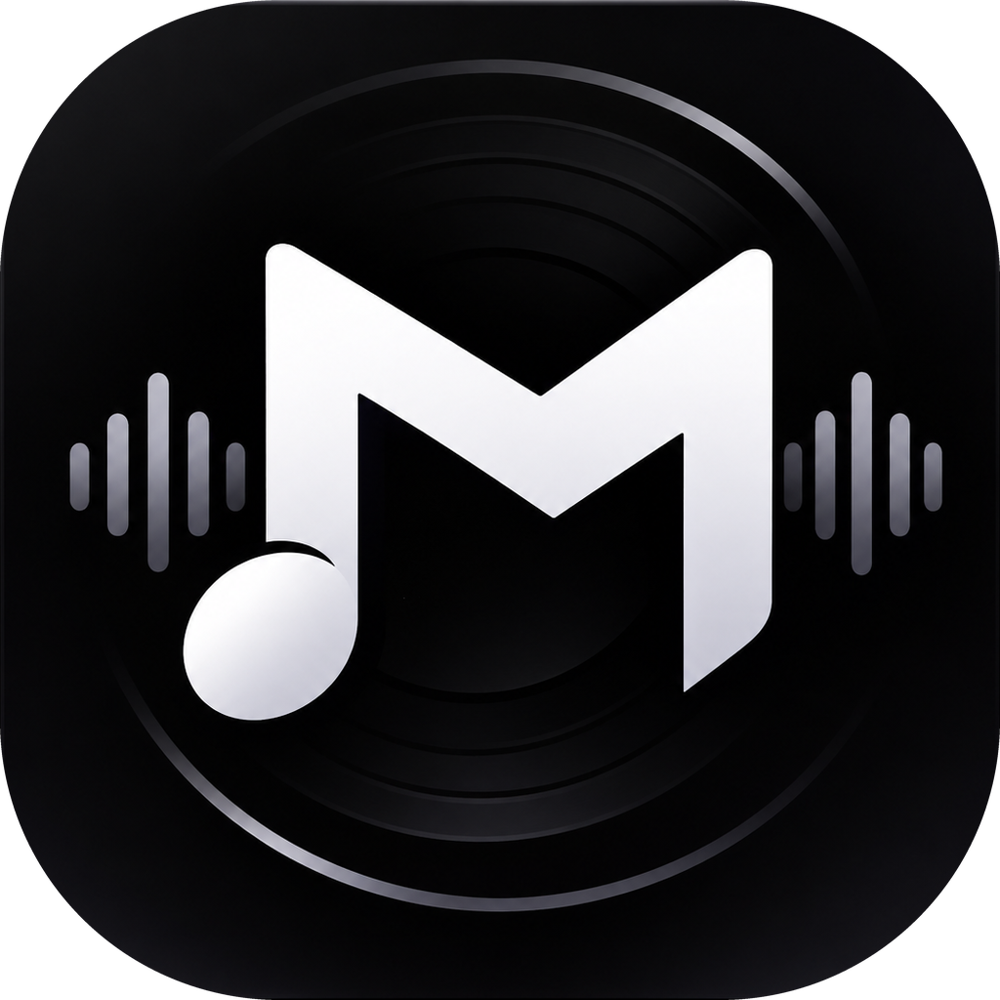
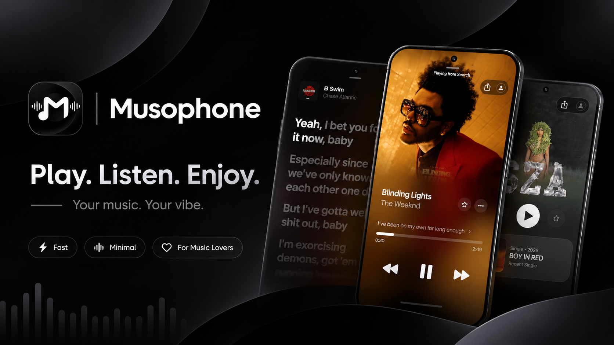

<h1>MusoPhone</h1>

<b>An independent, premium Android music player.</b> 
True-black AMOLED design · hi-res audio · word-synced lyrics

<b>Built by <a href="mailto:eagoxstudio@gmail.com">EAGOX STUDIO TEAM</a></b>

 

[**Download**](#download) &nbsp;·&nbsp; [**What's new**](#whats-new) &nbsp;·&nbsp; [**Features**](#features) &nbsp;·&nbsp; [**Contributing**](#contributing) &nbsp;·&nbsp; [**Disclaimer**](#disclaimer)

> [!IMPORTANT]
> MusoPhone is not affiliated with, endorsed by, or connected to YouTube or Google in any way. Use it at your own discretion.

---

<h2>What's new in 2.7</h2>

Version code <b>51</b> · released 25 November 2026 · <a href="release/v2.7/RELEASE_NOTES.md">release notes</a>

| | Change |
| :-- | :-- |
| **Home** | The masthead lockup is a touch larger and sits further left, at its original aspect ratio. |
| **Player** | The enclosing black panel around the controls is gone — the lyric line, timeline, transport, volume, modes, actions and output label now sit directly on the player's own backdrop. |

Playback, queue, lyrics, routing and every existing feature are unchanged.

---

<h2>Features</h2>

<table>
  <tr>
    <td width="50%" valign="top">

<h3>Playback</h3>

- **Search, browse and play** anything available on YouTube Music.
- **Hi-Res lossless audio** — FLAC/ALAC from a configured module source, with YouTube Music as fallback.
- **Gapless playback with true crossfade**, adjustable 0–12s.
- **Automix [Beta]** — DJ-style transitions with beat-matching and tempo-stretching.
- **Offline downloads** — save tracks with embedded metadata.
- **Local music library** integration.
- **Background playback** via a proper foreground media session.
- **Apple-like lyrics animation** — credit to [binimum](https://github.com/binimum/am-lyrics).

    </td>
    <td width="50%" valign="top">

<h3>Experience</h3>

- **Animated album canvas** — motion artwork on the now-playing screen.
- **Word-synced lyrics** — word/syllable-level highlighting from multiple sources.
- **Lyrics providers** — credit to [lrc.red](https://lrc.red), [BiniLyrics](https://github.com/binimum), [BetterLyrics](https://github.com/better-lyrics/better-lyrics), [PaxSenix](https://lyrics.paxsenix.org), [LyricsPlus](https://github.com/ibratabian17/YouLyPlus), [SimpMusic](https://github.com/maxrave-dev/SimpMusic), [Unison](https://unison.boidu.dev), [Megalobiz](https://www.megalobiz.com), [KuGou](https://www.kugou.com), [LRCLIB](https://lrclib.net), [Musixmatch](https://www.musixmatch.com) and [Genius](https://genius.com).
- **Dynamic, artwork-driven theming** — Material palette extracted from album art.
- **Premium AMOLED UI** — true-black backdrop, refined charcoal surfaces, compact editorial page headers, artwork-first layouts, one coherent icon and motion language, Material 3 theming with eight accent palettes.

    </td>
  </tr>
  <tr>
    <td width="50%" valign="top">

<h3>Connectivity & Accounts</h3>

- **Sign in with your Google account** for personalized content.
- **Spotify integration** — connect your account to play your playlists and Liked Songs.
- **Discord Rich Presence** — in-app login, live track/artist/album and progress.
- **Scrobbling** to Last.fm and ListenBrainz.
- **Pluggable sources** — add, edit, test and health-check module sources.

    </td>
    <td width="50%" valign="top">

<h3>Controls & Tweaks</h3>

- **Per-network audio quality** — separate quality ceilings for Wi-Fi and mobile data.
- **Playback speed control** (0.5×–2.0×) and **skip silence**.
- **Sleep timer** — fixed presets or "stop after this track".
- **System equalizer** integration.
- **Bit-perfect USB exclusive output** — sends lossless tracks to a USB DAC unchanged, at each track's own rate and bit depth. Thanks to [Mornye](https://github.com/mornyeapp/Mornye) for the reference.
- **Stats for nerds** — codec, bit depth, sample rate, and more on the now-playing screen.

    </td>
  </tr>
</table>

---

<h2>Download</h2>

<b>MusoPhone 2.7</b> · version code 51 · Android 8.0 (API 26) or newer · signed with the same certificate as 2.6

Grab the latest signed APK from the [Releases](https://github.com/Alshahriar-07/Musophone/releases) page. Sideloading requires enabling "Install unknown apps" for whichever app you download it with.

| APK | Architecture | Size |
| :-- | :-- | --: |
| [`MusoPhone-v2.7.apk`](release/v2.7/MusoPhone-v2.7.apk) | universal (arm64-v8a + armeabi-v7a + x86_64) | 84.3 MB |
| [`MusoPhone-v2.7-arm64-v8a.apk`](release/v2.7/MusoPhone-v2.7-arm64-v8a.apk) | arm64-v8a | 46.9 MB |
| [`MusoPhone-v2.7-armeabi-v7a.apk`](release/v2.7/MusoPhone-v2.7-armeabi-v7a.apk) | armeabi-v7a | 40.2 MB |
| [`MusoPhone-v2.7-x86_64.apk`](release/v2.7/MusoPhone-v2.7-x86_64.apk) | x86_64 | 49.4 MB |

Sums: [`SHA256SUMS.txt`](release/v2.7/SHA256SUMS.txt) · build details: [`build-info.txt`](release/v2.7/build-info.txt) · notes: [`RELEASE_NOTES.md`](release/v2.7/RELEASE_NOTES.md) · history: [`CHANGELOG.md`](CHANGELOG.md)

Project website: <https://musophone.vercel.app>

---

<h2>Contributing</h2>

We welcome contributions to MusoPhone. Please review the [Contributing Guide](CONTRIBUTING.md) and [Code of Conduct](CODE_OF_CONDUCT.md) before submitting a pull request.

[**Contributing Guide**](CONTRIBUTING.md) &nbsp;·&nbsp; [**Code of Conduct**](CODE_OF_CONDUCT.md) &nbsp;·&nbsp; [**Maintainers**](MAINTAINERS.md) &nbsp;·&nbsp; [**Additional Docs**](ADDITIONAL.md)

<h3>Thanks to all contributors ❤</h3>

**Designed and developed by [EAGOX STUDIO TEAM](mailto:eagoxstudio@gmail.com).**

Complete credits in [`Credit.md`](Credit.md).

---

<h2>Disclaimer & Legal Notice</h2>

MusoPhone is an independent, community-driven third-party audio player and client. It is **not** associated with Google LLC, YouTube Music, Deezer, Telegram, or any of their parent companies.

- **No media hosting** — MusoPhone does not host, upload, or store copyrighted music files. It operates strictly as an interface to scan local device storage or stream media directly from public, public-facing, or user-authenticated APIs.
- **Fair use & API usage** — this software is created solely for personal research, educational, and fair-use purposes. The user is entirely responsible for ensuring their usage aligns with their local copyright laws and YouTube Terms of Service.
- **No ad-blocking guarantee** — while MusoPhone focuses on providing a clean listening environment, it does not guarantee permanent bypasses or modifications to commercial third-party platform conditions.
- **Copyleft** — MusoPhone is free software under the GPLv3. The license does not let anyone forbid others from selling or redistributing copies, but any distribution must come with the Corresponding Source under the same license.

---

<h2>License</h2>

This project is licensed under the **GNU General Public License v3.0 (GPLv3)**. See the [LICENSE](LICENSE) file for details.

© EAGOX STUDIO TEAM · MusoPhone is an independent project.

